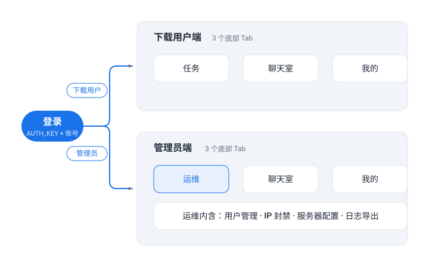

# Catdock 安卓 App — 双角色重设计方案

> 版本：v1.0 ｜ 日期：2026-10-28 ｜ 状态：待评审
> 目标：为管理员提供完整的移动端管理能力，按角色分流导航，界面统一对齐网页「极简」主题。

---

## 一、已知问题（当前版本发现）

| 编号 | 现象 | 初步判断 | 计划 |
|---|---|---|---|
| BUG-1 | **切换账号后切回，正在下载的视频不显示进度，也无法播放预览** | 疑似全局 ViewModel / 会话缓存未随账号切换刷新：任务列表与播放鉴权仍使用旧会话 token 或旧任务缓存 | **优先于重设计修复**（核心体验），阶段一处理 |
| BUG-2 | **视频播放不支持全屏** | 播放页未处理横屏全屏模式（Activity 方向锁定 + 沉浸式隐藏系统栏 + SurfaceView 比例适配缺失） | 阶段一随播放器一起改造 |
| BUG-3 | ~~聊天室历史消息为空、新消息拉不到~~ | 服务端版本过旧：消息被过滤（网页端同样受影响） | **已解决**（2026-10-28）：服务端容器已用最新源码重新构建部署，聊天功能恢复正常 |

## 二、设计语言（对齐网页「极简」主题 flat）

| 网页 CSS 变量 | App 对应 | 值 |
|---|---|---|
| `--bg` | 页面背景 | `#f5f7fa`（暗色 `#111827`） |
| `--card` | 卡片 | `#ffffff`（暗色 `#1e293b`） |
| `--border` | 卡片描边 1dp | `#e2e5ea` |
| `--primary` | 主蓝（按钮/选中态/链接） | `#1a73e8` |
| `--primary-soft` | 次级按钮/徽章底色 | `#e8f0fe` |
| `--green / --amber / --red`（+ 各自 soft） | 任务状态徽章 | `#1e8e3e / #e37400 / #d93025` |
| `--radius: 12px` | 卡片圆角 12dp、阴影极轻 | — |

风格要点：

- **描边为主、阴影极轻**，保持网页极简的平面感
- 底部导航去掉 Material 默认选中色块，选中态只用主蓝图标 + 文字
- 按钮两级：实心蓝主按钮 / soft 蓝底蓝字次按钮（对齐网页 `.btn` / `.btn-soft`）
- 顶栏统一放服务器连接状态灯（对齐网页状态灯）

## 三、信息架构（按角色分流）



```
登录（AUTH_KEY + 账号密码）
├── 下载用户（role=user）→ 3 个底部 Tab
│   ├── 任务     下载列表 + 新建任务 FAB + 轮询自动刷新
│   ├── 聊天室   群聊（历史 + 轮询）
│   └── 我的     账号卡片 / 外观主题 / 服务器信息 / 退出登录
└── 管理员（role=admin）→ 3 个底部 Tab
    ├── 运维     用户管理 / IP 封禁 / 服务器配置 / 日志导出（顶部次级 Tab 切换）
    ├── 聊天室   与下载用户端完全一致
    └── 我的     与下载用户端完全一致
```

登录后按 `/me.role` 分流到**两套独立导航壳**，互不可见。退出登录回到登录页，保留上次服务器地址预填。

## 四、页面明细

### 下载用户端

- **任务**：保留现有列表 + 4s 轮询 + FAB；卡片视觉刷新（状态徽章 soft 底色、细进度条、图标化操作按钮）
- **聊天室**：逻辑不动（BUG-3 修复后即正常）
- **我的**（新增）：账号卡片（用户名 + 角色徽章）、外观（跟随系统/浅色/深色）、服务器信息（当前地址/前缀）、退出登录

### 管理员端（3 Tab）

**运维**：一个 Tab 承载全部管理功能，内部用顶部次级 TabRow 切换四个子页：

| 子页 | 功能 | 对应 API（均已存在） |
|---|---|---|
| 用户管理 | 用户列表（用户名/角色徽章/状态）、添加用户（用户名/密码/角色单选）、重置密码、删除（二次确认、不能删自己） | `GET /admin/users`、`POST /admin/users/add\|delete\|password` |
| IP 封禁 | 封禁列表（IP/原因/时间）、手动封禁、解封 | `GET /admin/bans`、`POST /admin/bans/add\|delete` |
| 服务器配置 | 概览：版本/端口/前缀/在线数/任务数/封禁数分组展示；AUTH_KEY 掩码显示 + 「重置密钥」（确认弹窗 → 随机新值） | `GET /config`、`POST /admin/auth-key` |
| 日志导出 | 日期范围选择（≤15 天）→ 下载 .log 文件 | `GET /admin/logs/export?start&end` |

**聊天室 / 我的**：与下载用户端完全一致（复用同两个页面）。

管理员**不设任务 Tab**（`GET /tasks` 仅返回自己的任务，管理员无下载功能）。

## 五、实施计划

1. **阶段一**：BUG-1 修复（账号切换状态刷新）+ BUG-2 播放器全屏 + 主题层重写（色板/组件统一极简风格）+ 角色路由 + 管理员 3 Tab 骨架（运维内四子页骨架）+ 用户端「我的」
2. **阶段二**：运维 — 用户管理 + IP 封禁
3. **阶段三**：运维 — 服务器配置 + AUTH_KEY 热更 + 日志导出

每阶段构建后真机验收（无线调试随时抓日志）。

## 六、待确认项

1. **主题范围**：只做「极简」明暗双模式（跟随系统，可手动切换），不实现网页其余 5 套主题 —— 建议保持 App 轻量
2. **全局任务视图**：后端暂无 `/admin/tasks`，管理员看不到所有用户的任务；是否在服务端加该接口并在 App 提供只读列表？
3. **过滤规则**：广告关键词/文件名过滤的管理页，你的设计未列入运维子页；要不要作为运维第五个子页（`GET/POST /admin/filters`）？

## 七、当前版本（v1.0.0-debug）已具备

- 登录（服务器完整地址直填，自动拆分主机与前缀）、会话持久化
- 任务列表 4s 静默轮询（无手动刷新按钮、无布局跳动）、新建下载任务、暂停/恢复/置顶/删除
- 视频预览播放（内嵌播放器，全屏待改造）
- 聊天室 5s 轮询、发送消息
- 全量网络日志（`adb logcat -s CatdockNet`）、崩溃捕获与本地报告页
- Material You 动态取色（重设计后将改为固定极简色板，可选保留）
